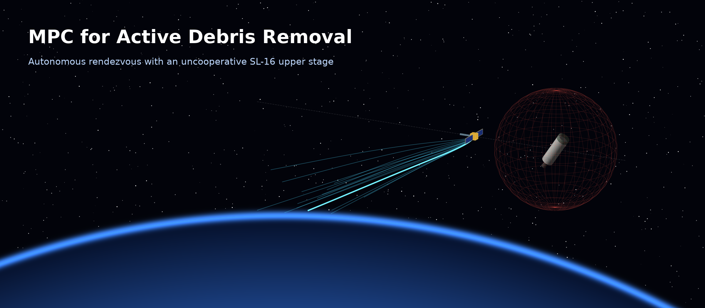
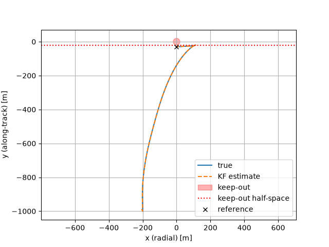
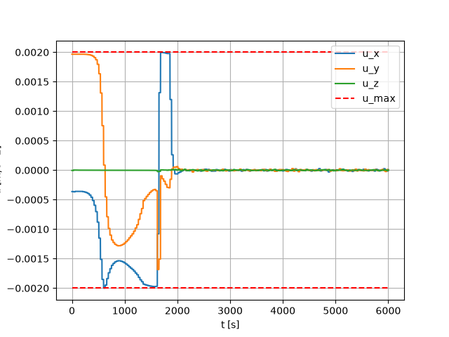
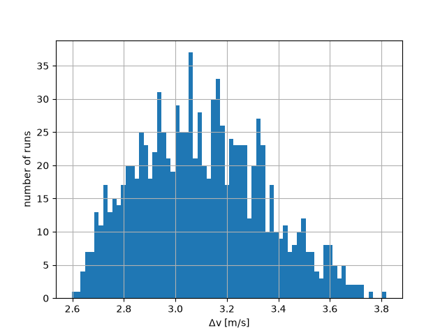
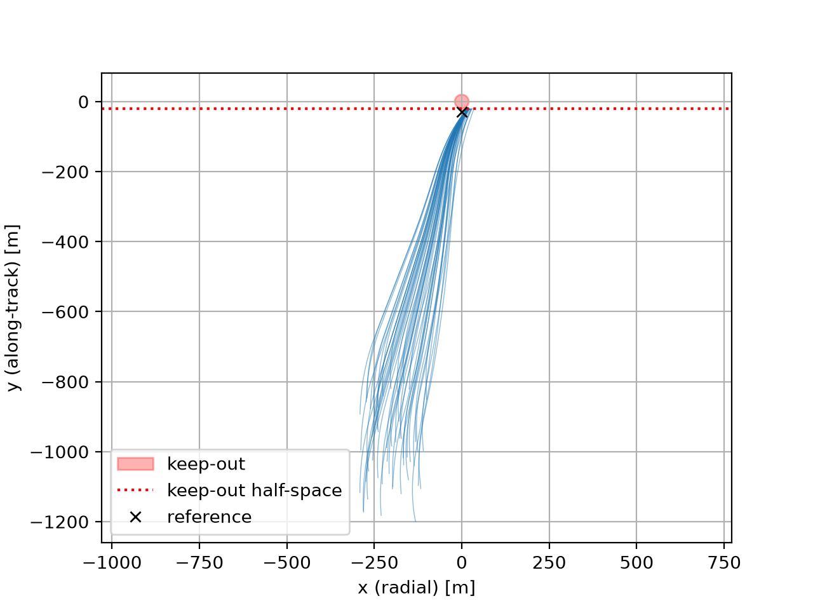

<a id="readme-top"></a>

<div align="center">

  <h1>MPC for Active Debris Removal</h1>
  <h3>Autonomous rendezvous with an uncooperative SL-16 upper stage</h3>

  <p>
    Linear MPC · Kalman filtering · Nonlinear J2 plant · 1000-run Monte Carlo
  </p>

  
  

  <br /><br />
  

</div>

<details>
  <summary>Table of Contents</summary>
  <ol>
    <li><a href="#about-the-project">About the project</a></li>
    <li><a href="#scenario">Scenario</a></li>
    <li><a href="#architecture">Architecture</a></li>
    <li><a href="#mpc-formulation">MPC formulation</a></li>
    <li><a href="#results">Results</a></li>
    <li><a href="#analyses-and-lessons-learned">Analyses and lessons learned</a></li>
    <li><a href="#assumptions-and-limitations">Assumptions and limitations</a></li>
    <li><a href="#getting-started">Getting started</a></li>
    <li><a href="#roadmap">Roadmap</a></li>
    <li><a href="#note-on-ai-assistance">Note on AI assistance</a></li>
    <li><a href="#contact">Contact</a></li>
  </ol>
</details>


## About the project

The project idea was born after a project done in the KTH course SD2900 Fundamentals of Spaceflight, in which the main objective was to design start-to-end a mission of active debris removal using a low thrust electric engine as main propulsion. While for a simple course project the mission analysis is feasible, the specific technologies required to handle the final approach and clamping of the target were too complex and not intended to be developed.    
This project is trying to further explore the viability of such missions, which have been becoming more relevant entering the era of "new space" and big satellites constellations.   
The objective is to develop an MCP to handle the final approach to a uncooperative target, starting from some predefined starting conditions till the final clamping of the target at the throat of the nozzle. The chosen target for the mission is one of the multiple SL-16 upper stages orbiting in LEO, due in particular to the critical danger it is posing to future missions in case of a collision with any other target (multiple sources).    
The repository provides the information necessary to run the scripts and follows a 5-phase plan defined in the "<a href="#roadmap">Roadmap</a>" section.


<p align="right">(<a href="#readme-top">back to top</a>)</p>


## Scenario

| | |
|---|---|
| Target | SL-16 upper stage, LEO, 843.5 km, i ≈ 71° |
| Chaser | 500 kg, 1 N-class monopropellant RCS → u<sub>max</sub> = 2·10⁻³ m/s² |
| Initial condition | 100–300 m below, 800–1200 m behind the target and y-relative speed offset |
| Final condition | hold point on V-bar, 30 m behind the target (in phase 2) |
| Out of scope | phasing (electric propulsion) |

The starting conditions were chosen considering a long phasing at LEO from a lower orbit.   
Other initial conditions could be chosen for the same problem.

<p align="right">(<a href="#readme-top">back to top</a>)</p>


## Architecture
(Phase 2)
```
Nonlinear plant (two-body + J2, ECI) ──► LIDAR (relative position) ──► Kalman filter
          ▲                                                                │
          └──────────── thrust (ZOH, 30 s) ◄──── Linear MPC (every 30 s) ◄─┘
```

| Block | Model | Rate |
|---|---|---|
| Plant | two-body + J2 for both spacecraft | 1 s |
| Sensor | LIDAR relative position, σ(r) = 0.1 m + r / 3000 | 1 s |
| Filter | linear KF, Schweighart-Sedwick model | 1 s |
| Controller | linear MPC, Schweighart-Sedwick model, H<sub>p</sub> = 20 (600 s) | 30 s |

<p align="right">(<a href="#readme-top">back to top</a>)</p>


## MPC formulation
(Phase 2)

$$
\begin{aligned}
\min_{u,\,\varepsilon}\quad & \lVert x_{H_p}-x_{\mathrm{ref}}\rVert_P^2+\sum_{k=0}^{H_p-1}\Big(\lVert x_k-x_{\mathrm{ref}}\rVert_Q^2+\lVert u_k\rVert_R^2+\rho\,\varepsilon_k+\rho_v\,\varepsilon_{v,k}\Big)\\
\text{s.t.}\quad & x_{k+1}=A_d x_k+B_d u_k,\qquad x_0=\hat{x}\\
& R_{ko}-n^\top r_{k+1}\le\varepsilon_k\\
& \lVert v_{k+1}\rVert_2\le v_{\max}+\varepsilon_{v,k}\\
& \lVert u_k\rVert_2\le u_{\max},\qquad \lVert u_k-u_{k-1}\rVert_2\le\Delta u_{\max}\\
& \varepsilon_k\ge 0,\qquad \varepsilon_{v,k}\ge 0
\end{aligned}
$$

**Design choices**

<!-- For each one, 1–2 sentences in your own words: what and why. -->
* **Weights:** Bryson's rule (Q<sub>ii</sub> = 1/tol², R = I/u<sub>max</sub>²); terminal cost P from the DARE.
* **Soft constraints:** exact L1 penalty, ρ above the constraint multiplier.
* **Keep-out half-space:** fixed normal along the line to the reference.
* **Speed limit tied to the horizon:** v<sub>max</sub> = 0.8 u<sub>max</sub> H<sub>p</sub> Δt.
* **Multi-rate:** MPC at 30 s.

<p align="right">(<a href="#readme-top">back to top</a>)</p>


## Results

### Nominal run

<!-- Key numbers from run_nominal.py: Δv, settling time, min margin, solve time. -->

<p align="center">
  
  
</p>

### Monte Carlo (1000 runs)

| Metric | Mean | p95 | Max |
|---|---|---|---|
| Δv [m/s] | 3.10 | 3.53 | 3.82 |
| Settling time [s] | 1698 | 1887 | 1990 |
| Max speed [m/s] | 0.96 | — | 0.96 (limit 0.96) |

* Worst keep-out margin: **+0.83 m** (never violated)
* Settled within one orbit: **1000 / 1000**
* Solver failures: **0 / 1000**
* KF consistency (fraction inside 3σ): mean **0.9975**, worst 0.979

<p align="center">
  
  
</p>

<p align="right">(<a href="#readme-top">back to top</a>)</p>


## Analyses and lessons learned

<!-- One short paragraph each, in your own words. -->
* **Multi-rate MPC:** For the initial approach a multi-rate approach for the 3DoF MPC was used; this compromise guarantees lighter computational calculations and faster runs, while also providing the controller a better look into the future state of the chaser. This solution, although useful during the first approaching phase, will not be viable during the final docking as a more responsive MPC is required.
* **Validity envelope:** 
* **Thrust-dependent model error in the KF:** ...
* **Soft constraints below the exact-penalty threshold:** During the code-writing and testing phase of the project multiple times slack variables had to be used to correct various problems with the MPC, that mainly lead CVXPY to crash as the convex problem became infeasible for the solver. As it stands for phase 2, slack variables are used to make the problem solvable in case either the maximum velocity v_{\max} is overpassed or if the half-space limit is violated.

<p align="right">(<a href="#readme-top">back to top</a>)</p>


## Assumptions and limitations
(phase 2)

* KF process and measurement noise (Q, R) and measurement model C (relative position only) are declared assumptions
* KF process noise inflated ×9
* Perfect attitude, omnidirectional thrust 
* No minimum impulse
* Linear model valid below ~1 km (see analyses)

<p align="right">(<a href="#readme-top">back to top</a>)</p>


## Getting started

```sh
git clone <repository-url>
cd <repository-folder>
pip install -r requirements.txt

python run_nominal.py        # single run, metrics and figures
python run_monte_carlo.py    # 1000 runs (~6 h)
```

<p align="right">(<a href="#readme-top">back to top</a>)</p>


## Roadmap

- [x] Phase 1 – Relative dynamics (CW, Schweighart-Sedwick) and nonlinear J2 plant
- [x] Phase 2 – Linear translational MPC with KF and Monte Carlo validation
- [ ] Phase 3 – Attitude dynamics
- [ ] Phase 4 – Attitude MPC (reaction wheels / RCS)
- [ ] Phase 5 – Nonlinear coupled 6-DoF MPC

<p align="right">(<a href="#readme-top">back to top</a>)</p>


## Note on AI assistance

<!-- Your own words: what you designed and wrote, what you used Claude for. -->

<p align="right">(<a href="#readme-top">back to top</a>)</p>


## Contact

Leonardo Angeli – leonardo.angeli2004@gmail.com or langeli@kth.se linkedin: www.linkedin.com/in/leonardo-angeli-2a84b5231

<p align="right">(<a href="#readme-top">back to top</a>)</p>
